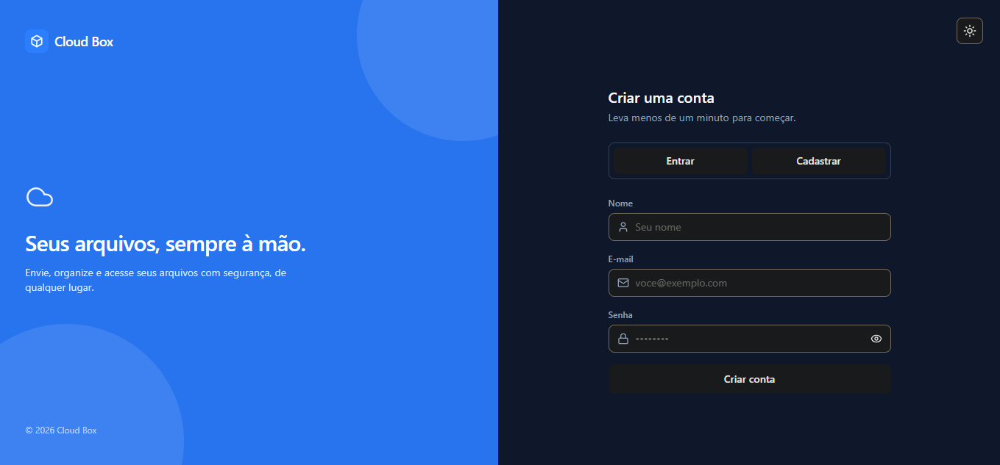
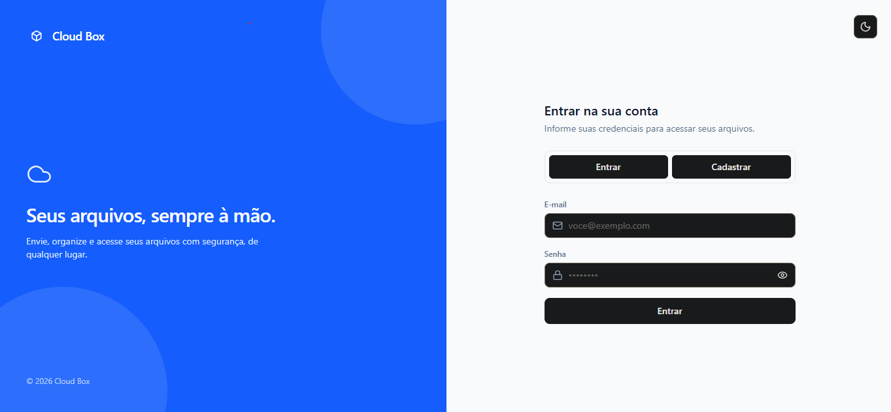
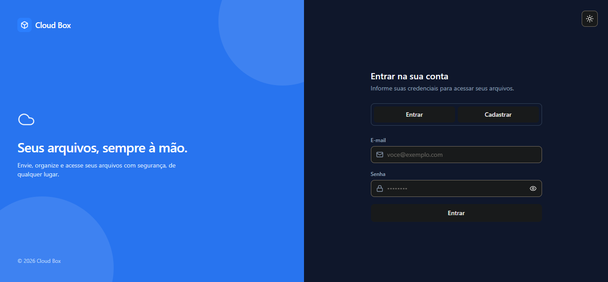
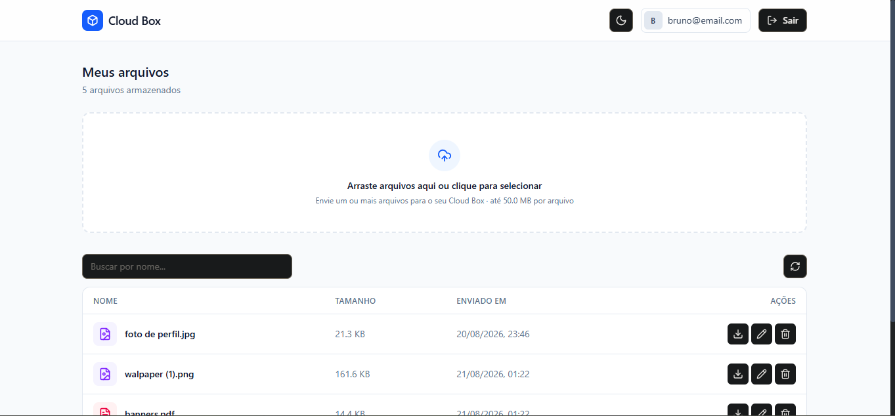
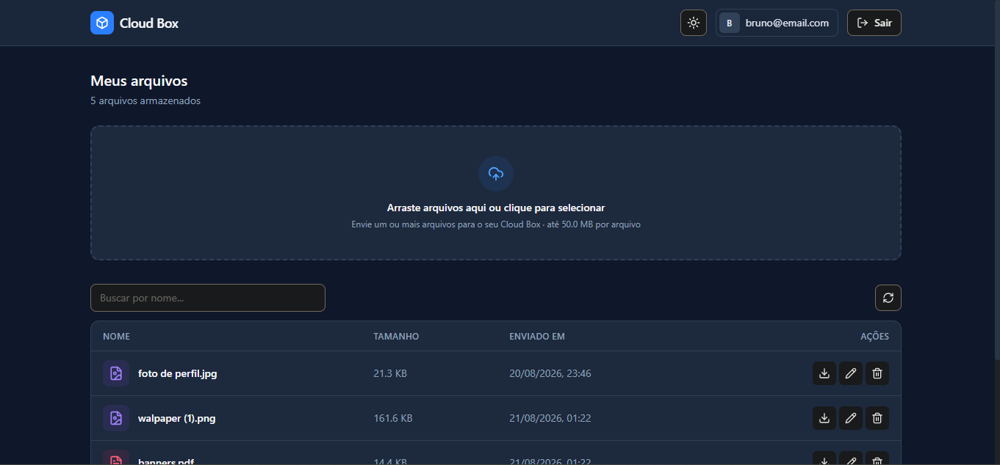
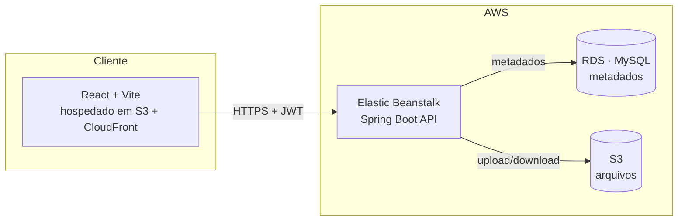

<div align="center">
  

  # Cloud Box

  ### Seus arquivos, sempre à mão.

  Sistema de armazenamento de arquivos em nuvem, full-stack — API REST em
  Spring Boot e frontend em React, hospedados na AWS. Upload, listagem,
  renomeação e exclusão de arquivos com autenticação JWT.

  
  
  
  
  
  
  
  

## ☁️ Projeto rodando na nuvem
  [Demo ao vivo na AWS](https://d1k6x7zqjed6oi.cloudfront.net)
</div>

---

## 📖 Sobre o projeto

O **Cloud Box** é um sistema de armazenamento de arquivos "estilo Google Drive": o
usuário se cadastra, faz login e pode enviar, listar, baixar, renomear e excluir
seus próprios arquivos — tudo protegido por autenticação JWT e com os arquivos
armazenados de verdade na nuvem (AWS S3), não em disco local.

O projeto foi construído em duas partes independentes que conversam via API REST:

- **Backend** — API Java/Spring Boot, responsável por autenticação, regras de
  negócio, persistência (AWS RDS) e integração com o AWS S3.
- **Frontend** — interface React que consome essa API, com upload por
  drag-and-drop, tema claro/escuro e feedback visual (toasts) para cada ação.

## 📸 Screenshots

<div align="center">

**Register**





**Login**




**Dashboard**




</div>

## ✨ Funcionalidades

- 🔐 Cadastro e login com autenticação **JWT**
- 📤 Upload de arquivos com **drag-and-drop** e barra de progresso
- 📁 Listagem, **renomear**, **baixar** e **excluir** arquivos
- 🌗 Tema **claro/escuro** com persistência local
- ⚠️ Tratamento de erros de ponta a ponta (sessão expirada, arquivo duplicado,
  limite de tamanho excedido, credenciais inválidas)
- 📦 Limite de upload de 50MB, validado tanto no cliente quanto no servidor
- 🔒 Autorização por usuário em nível de rota (`@PreAuthorize`) — um usuário
  não consegue acessar ou apagar arquivos de outro

## 🏗️ Arquitetura



**Fluxo de autenticação:** o login retorna um JWT assinado (HS512) e o ID do
usuário. O token é enviado em todo request subsequente via header
`Authorization: Bearer <token>` e validado a cada chamada; o backend também
confere, por rota, se o `idUsuario` da URL corresponde ao usuário autenticado.

**Fluxo de upload:** o arquivo vai direto do navegador para a API via
`multipart/form-data`; a API valida tamanho e duplicidade, envia o binário
para o S3 e grava os metadados (nome, tamanho, tipo MIME, data) no RDS.

## 🛠️ Tecnologias utilizadas

### Frontend
- **React** + **Vite** (build e bundling ultra rápido)
- **Axios** (integração com a API REST)
- **Tailwind CSS** (estilização responsiva, com suporte a tema claro/escuro)
- **React Router** (navegação e rotas protegidas)
- **react-hot-toast** (feedback visual de sucesso/erro)

### Backend
- **Java** com **Spring Boot**
- **Spring Security** + **JWT** (autenticação e autorização)
- **Spring Data JPA** (persistência)
- **AWS SDK** (integração com o S3)

### DevOps & Cloud
- **AWS S3** (armazenamento de arquivos e hospedagem estática do frontend)
- **AWS CloudFront** (CDN e terminação HTTPS para frontend e API)
- **AWS Elastic Beanstalk** (hospedagem e gerenciamento da API)
- **AWS RDS / MySQL** (banco de dados relacional gerenciado)
- **Nginx** (proxy reverso e configuração de limite de upload no Beanstalk)


## ☁️ Projeto rodando na nuvem
[Demo ao vivo na AWS](https://d1k6x7zqjed6oi.cloudfront.net)

## 🚀 Rodando localmente

### Pré-requisitos
- Node.js 18+
- A API do Cloud Box rodando (local ou a instância na AWS)

### Frontend

```bash
git clone <https://github.com/BrunoSlvCh/cloud-box-aws>
cd cloud-box-frontend

npm install

# Crie o arquivo .env a partir do exemplo (na pasta frontend)
cp .env.example .env

# O conteúdo do seu arquivo .env deve ficar assim:
VITE_API_BASE_URL=https://dwcfv7yah7ac3.cloudfront.net

npm run dev
# abre em http://localhost:5173
```

## 📡 Principais endpoints da API

| Método | Rota | Descrição |
|---|---|---|
| `POST` | `/v1/auth/register` | Cria uma nova conta |
| `POST` | `/v1/auth/login` | Autentica e retorna `{ token, expireIn, id }` |
| `POST` | `/v1/arquivos/novoArquivo/idUsuario/{id}` | Upload de arquivo (multipart) |
| `GET` | `/v1/arquivos/idUsuario/{id}/arquivos` | Lista os arquivos do usuário |
| `GET` | `/v1/arquivos/download/idUsuario/{id}/{nome}` | Download do arquivo |
| `PATCH` | `/v1/arquivos/idUsuario/{id}/{nomeAtual}/para/{novoNome}` | Renomeia um arquivo |
| `DELETE` | `/v1/arquivos/idUsuario/{id}/nome/{nome}` | Exclui um arquivo |

Todas as rotas de arquivo exigem o header `Authorization: Bearer <token>` e são
protegidas por `@PreAuthorize`, garantindo que cada usuário só acesse seus
próprios dados.

## 🧠 Decisões técnicas e desafios

- **Autorização por dono do recurso**: cada rota de arquivo confere, via
  `@PreAuthorize`, se o `idUsuario` da URL bate com o usuário autenticado no
  token — evitando que um usuário acesse ou apague arquivos de outro.
- **Sincronização de limites entre camadas**: o limite de 50MB por arquivo é
  validado em três pontos independentes — no frontend (evita upload
  desnecessário), no Spring (`multipart.max-file-size`) e no nginx do Elastic
  Beanstalk (`client_max_body_size`), que fica na frente da aplicação. Ajustar
  só o Spring não bastava, pois o proxy rejeitava a requisição antes dela
  sequer chegar à API.
- **Tratamento de erros consistente**: um `@RestControllerAdvice` centraliza
  todas as exceções da API em um formato de resposta previsível, permitindo
  que o frontend trate cada status HTTP (400, 401/403, 409, 413, 500) com uma
  mensagem clara para o usuário, sem expor detalhes internos.

## 🗺️ Possíveis melhorias futuras

- [ ] Testes automatizados (JUnit no backend, Vitest/Testing Library no front)
- [ ] Compartilhamento de arquivos entre usuários
- [ ] Pré-visualização de imagens/PDFs sem precisar baixar
- [ ] CI/CD (GitHub Actions) para deploy automático

## 📄 Licença

Este projeto está sob a licença MIT 

## ☁️ Projeto rodando na nuvem
[Demo ao vivo na AWS](https://d1k6x7zqjed6oi.cloudfront.net)

## 👤 Autor

Feito por **Bruno da Silva Chagas** — [https://br.linkedin.com/in/bruno-da-silva-chagas-5ab7bb377](#Linkedin) · [https://github.com/BrunoSlvCh](#GitHub)