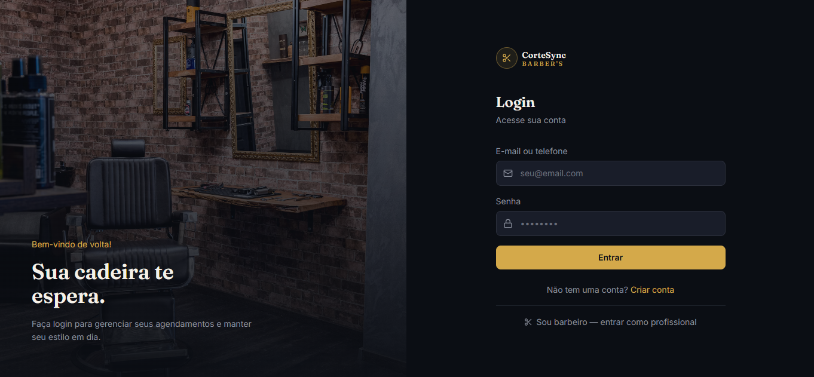
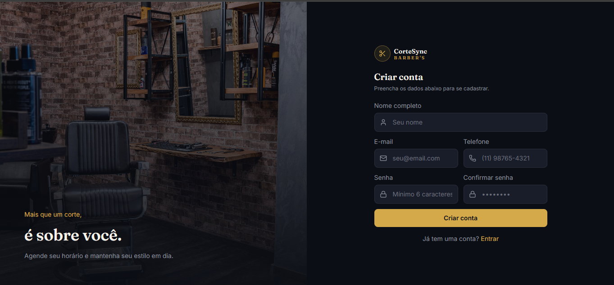
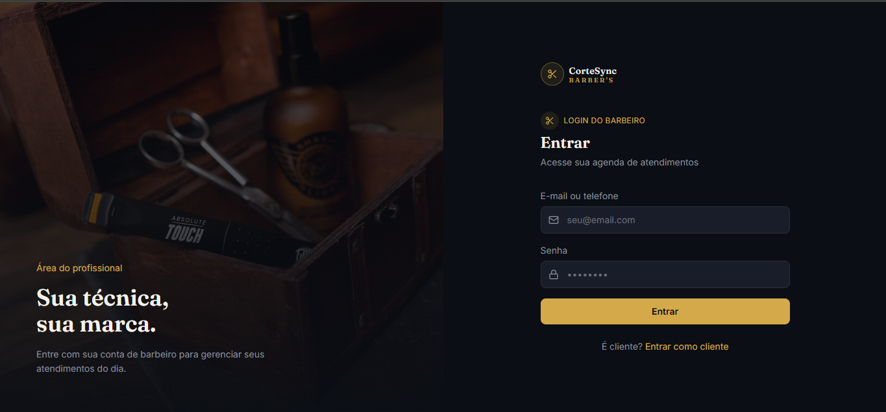
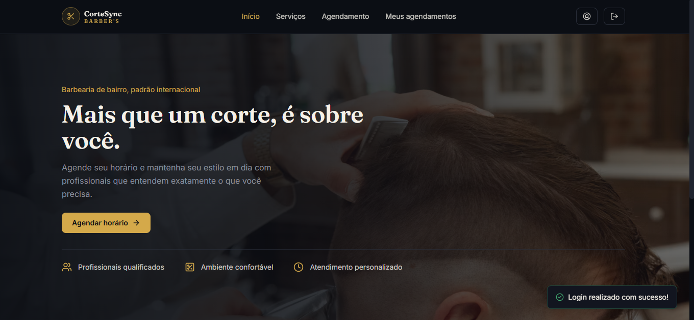
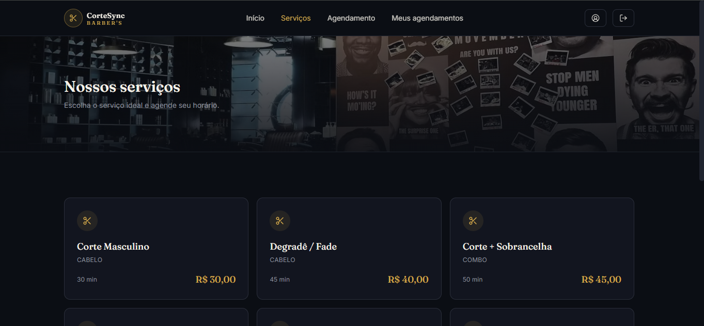
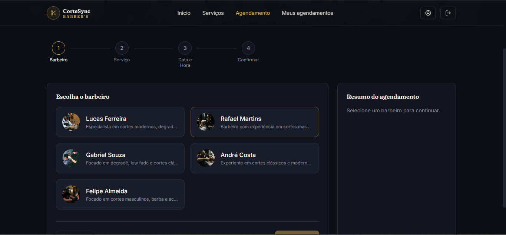
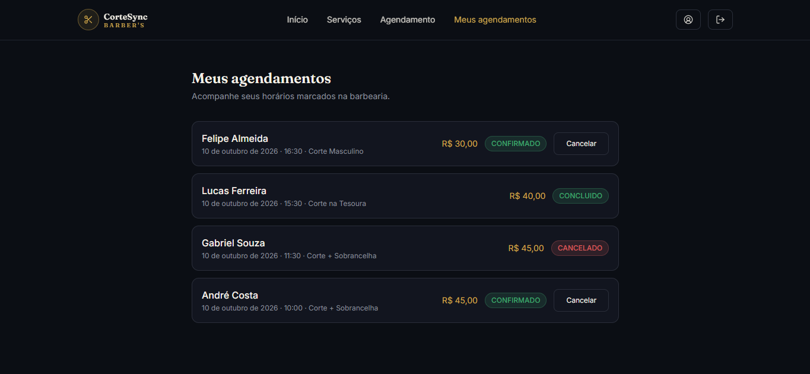

<div align="center">

# ✂️ CorteSync — Front-end

**Sistema web de agendamento para barbearias.**
Clientes marcam horários online, barbeiros acompanham a própria agenda e o administrador gerencia toda a operação.

[](http://52.207.33.184:3000)


[Demonstração](#demonstração) ·
[Telas](#telas) ·
[Funcionalidades](#funcionalidades) ·
[Tecnologias](#tecnologias) ·
[Como executar](#como-executar) ·
[Docker](#docker) ·
[API](#endpoints-da-api-utilizados)

</div>

---

## Sobre o projeto

O **CorteSync** é a interface web de um sistema de agendamento para barbearias. Ele consome uma API REST em Spring Boot e entrega três experiências em uma única aplicação, cada uma com suas telas e permissões:

- **Cliente:** escolhe o barbeiro, os serviços, o dia e o horário, e acompanha ou cancela os próprios agendamentos.
- **Barbeiro:** entra por um login próprio e vê só os atendimentos dele, atualizando o status de cada um.
- **Administrador:** acompanha números do negócio e gerencia barbeiros, serviços e todos os agendamentos.

## Demonstração

> **🔗 Acesse: [http://52.207.33.184:3000](http://52.207.33.184:3000)**

- É um ambiente de demonstração (HTTP, sem certificado) e pode ficar indisponível.
- Para testar o fluxo de cliente, crie uma conta na tela inicial.
- As áreas de barbeiro e de administrador exigem contas específicas, criadas pelo administrador.

## Telas

<table>
  <tr>
    <td align="center" width="50%">
      <br />
      <sub><b>Login</b> — por e-mail ou telefone</sub>
    </td>
    <td align="center" width="50%">
      <br />
      <sub><b>Criar conta</b> — formulário compacto, sem rolagem</sub>
    </td>
  </tr>
  <tr>
    <td align="center">
      <br />
      <sub><b>Login do barbeiro</b> — acesso próprio para profissionais</sub>
    </td>
    <td align="center">
      <br />
      <sub><b>Início</b> — apresentação e acesso rápido ao agendamento</sub>
    </td>
  </tr>
  <tr>
    <td align="center">
      <br />
      <sub><b>Serviços</b> — cada card leva direto ao agendamento</sub>
    </td>
    <td align="center">
      <br />
      <sub><b>Agendamento</b> — 4 etapas com resumo lateral</sub>
    </td>
  </tr>
  <tr>
    <td align="center" colspan="2">
      <br />
      <sub><b>Meus agendamentos</b> — histórico com status e cancelamento</sub>
    </td>
  </tr>
</table>

## Funcionalidades

### Cliente
- Cadastro e login por **e-mail ou telefone**.
- Lista de **serviços** ativos; clicar em um serviço leva ao agendamento.
- **Agendamento em 4 etapas:** barbeiro → serviço(s) → data e horário → confirmação. Permite combinar mais de um serviço, mostra o valor e a duração totais e só oferece os **horários livres** do barbeiro no dia escolhido. Barbeiros inativos não aparecem.
- **Meus agendamentos:** histórico ordenado do mais recente ao mais antigo, com status e opção de **cancelar** os confirmados.
- **Meu perfil:** alterar nome, e-mail, telefone e senha.

### Barbeiro
- **Login exclusivo** em `/login-barbeiro`, acessível pelo link "Sou barbeiro" na tela de login.
- **Meus agendamentos:** só os atendimentos dele, separados em *Hoje* e *Próximos e anteriores*.
- Alteração do **status** direto ao lado de cada atendimento (Confirmado, Concluído).
- Atualização da própria **foto de perfil**.

### Administrador
- **Dashboard** com total de barbeiros e serviços, agendamentos do dia, clientes atendidos e agendamentos recentes.
- **Barbeiros:** cadastro em passo a passo (cria a conta de acesso e o barbeiro de uma vez), ativar/inativar, editar descrição e remover.
- **Serviços:** cadastrar, editar (nome, preço, duração, categoria), ativar/inativar e remover.
- **Agendamentos:** lista completa, filtro por status e troca de status (Confirmado, Concluído, Cancelado).

### Experiência de uso
- Tema escuro com detalhes em dourado, pensado para o público da barbearia.
- **Responsivo:** menu hambúrguer no celular e menu lateral deslizante no painel do admin.
- Notificações (toasts) para sucesso e erro, estados vazios e carregamento nas listas.
- Rotas protegidas por perfil; sessão com expiração e redirecionamento ao login quando o token deixa de valer.

## Tecnologias

| Área | Tecnologia |
|---|---|
| Interface | React 19 |
| Roteamento | React Router 7, com guards por perfil |
| Build e desenvolvimento | Vite 8 |
| Estilo | Tailwind CSS 4 · ícones [lucide-react](https://lucide.dev) |
| Requisições HTTP | Axios (interceptors para o JWT e para erros) |
| Estado global | Context API (autenticação e notificações) |
| Qualidade de código | oxlint |
| Entrega | Docker multi-stage (Node 20 → Nginx) |
| Tipografia | Fraunces e Inter (Google Fonts) |

**Back-end consumido:** API REST em Java 21 + Spring Boot, com autenticação JWT e MySQL.

## Autenticação e perfis

1. O login devolve um **token JWT**, guardado no `localStorage` com a data de expiração.
2. Um interceptor do Axios envia `Authorization: Bearer <token>` em toda requisição. Uma resposta `401` encerra a sessão e leva ao login.
3. A API ainda não devolve o perfil do usuário no token, então o front decide **qual tela mostrar** assim: o administrador é reconhecido pelas variáveis `VITE_ADMIN_EMAIL` / `VITE_ADMIN_TELEFONE`, e o barbeiro pela tela de login usada (`/login-barbeiro`).
4. Isso só afeta a navegação. **As permissões de verdade são validadas pelo back-end** (`@PreAuthorize`) em cada requisição.

## Estrutura do projeto

```text
.
├── Dockerfile              # build (Node) + servidor (Nginx)
├── nginx.conf              # fallback para index.html (React Router)
├── .env.example            # modelo das variáveis de ambiente
├── public/
└── src/
    ├── api/                # cliente Axios e chamadas por recurso
    ├── assets/             # ilustrações
    ├── components/
    │   ├── booking/        # indicador de etapas e resumo do agendamento
    │   ├── layout/         # navbar, layout do admin, guards de rota, logo
    │   └── ui/             # Button, Input, Modal, Badge, Toggle, StatusSelect
    ├── context/            # AuthContext e ToastContext
    ├── pages/
    │   ├── public/         # Início, Serviços, Login, Cadastro, Agendamento,
    │   │                   # Meus agendamentos, Perfil, Login do barbeiro
    │   ├── barber/         # Meus agendamentos (barbeiro)
    │   └── admin/          # Dashboard, Barbeiros, Serviços, Agendamentos
    └── utils/              # formatação de moeda/datas e URLs de imagens
```

## Rotas

| Rota | Acesso | Descrição |
|---|---|---|
| `/` | Público | Redireciona para `/criar-conta` |
| `/inicio` | Público | Página inicial |
| `/servicos` | Público | Serviços disponíveis |
| `/login` · `/criar-conta` | Público | Entrar e cadastrar |
| `/login-barbeiro` | Público | Login exclusivo do barbeiro |
| `/agendamento` | Logado | Agendamento em 4 etapas |
| `/meus-agendamentos` | Logado | Histórico do cliente |
| `/perfil` | Logado | Dados da conta |
| `/barbeiro` | Barbeiro | Agenda do barbeiro |
| `/admin` | Admin | Dashboard |
| `/admin/barbeiros` · `/admin/servicos` · `/admin/agendamentos` | Admin | Gestão |

## Como executar

### Pré-requisitos
- **Node.js 20.19+** (ou 22.12+) e npm
- A **API** do CorteSync em execução e acessível

### Instalação

```bash
git clone https://github.com/BrunoSlvCh/corte-sync-application.git
cd <corte-sync-application>
npm install
```

### Variáveis de ambiente

Copie o modelo e ajuste os valores:

```bash
cp .env.example .env
```

| Variável | Descrição | Exemplo |
|---|---|---|
| `VITE_API_BASE_URL` | URL da API, **incluindo** o prefixo `/v1` | `http://localhost:8082/v1` |
| `VITE_ADMIN_EMAIL` | E-mail da conta de administrador | `admin@exemplo.com` |
| `VITE_ADMIN_TELEFONE` | Telefone da conta de administrador | `11999999999` |

### Scripts

```bash
npm run dev       # servidor de desenvolvimento em http://localhost:5173
npm run build     # gera a versão de produção em dist/
npm run preview   # serve a build localmente
npm run lint      # análise estática com oxlint
```

## Docker

O `Dockerfile` usa duas etapas: compila o projeto com Node 20 e serve a pasta `dist/` com Nginx na porta 80. O `nginx.conf` envia qualquer rota desconhecida para o `index.html`, o que faz o React Router funcionar ao recarregar a página (F5) em rotas como `/perfil`.

```bash
docker build -t cortesync-frontend .
docker run -d --name cortesync-frontend -p 3000:80 cortesync-frontend
```

A aplicação fica em `http://localhost:3000`. Como as variáveis são lidas no build, confirme o `.env` **antes** de rodar o `docker build`. Para forçar uma imagem do zero:

```bash
docker build --no-cache -t cortesync-frontend .
```

Com Docker Compose, o serviço do front pode ser declarado assim:

```yaml
frontend:
  build: ./cortesync-frontend   # pasta deste projeto
  container_name: cortesync-frontend
  restart: always
  ports:
    - "3000:80"
```

## Endpoints da API utilizados

Todas as rotas ficam sob o prefixo `/v1`. A coluna *Acesso* resume a regra de permissão aplicada pelo back-end.

| Recurso | Método e rota | Acesso |
|---|---|---|
| **Autenticação** | `POST /auth/register` · `POST /auth/login` | Público |
| **Serviços** | `GET /servico/servicos` | Logado |
| | `POST /servico/new` | Admin |
| | `PATCH /servico/nomeServico/{nome}/nome` · `/preco` · `/duracao` · `/categoria` | Admin |
| | `PATCH /servico/idServico/{id}/status/{status}` | Admin |
| | `DELETE /servico/delete/nomeServico/{nome}` | Admin |
| **Barbeiros** | `GET /barbeiro/barbeiros` | Logado |
| | `POST /barbeiro/new` (cria a conta e o barbeiro) | Admin |
| | `PATCH /barbeiro/descricao/id/{id}` | Admin |
| | `PATCH /barbeiro/id/{id}/status/{status}` | Admin |
| | `PATCH /barbeiro/usuario/{idUsuario}/foto` | O próprio barbeiro ou Admin |
| | `DELETE /barbeiro/delete/id/{id}` | Admin |
| **Agendamentos** | `POST /agendamento/new` | Logado |
| | `GET /agendamento/barbeiroId/{id}/data/{data}` (horários livres) | Logado |
| | `GET /agendamento/agendamentos/usuario/{idUsuario}` | O próprio cliente ou Admin |
| | `GET /agendamento/meus-agendamentos` | Barbeiro ou Admin |
| | `GET /agendamento/all` | Admin |
| | `PATCH /agendamento/idAgendamento/{id}/idUsuario/{idUsuario}` (cancelar) | Dono do agendamento, barbeiro do agendamento ou Admin |
| | `PATCH /agendamento/concluir/{id}` | Barbeiro do agendamento ou Admin |
| | `PATCH /agendamento/{id}/status` (volta para Confirmado) | Barbeiro do agendamento ou Admin |
| **Conta** | `PATCH /user/idUsuario/{id}/alterar-nome` · `/alterar-email` · `/alterar-telefone` · `/alterar-senha` | O próprio usuário ou Admin |

## Limitações conhecidas e próximos passos

- [ ] Incluir o **perfil (role) no JWT** ou expor um `GET /user/me`, para o front não depender de variáveis de ambiente para reconhecer o admin.
- [ ] Publicar com **HTTPS** e domínio próprio.
- [ ] **Upload de fotos** dos barbeiros (hoje é informada a URL da imagem).
- [ ] **Paginação** nas listagens de barbeiros, serviços e agendamentos.
- [ ] Permitir que o **barbeiro cancele** atendimentos pela própria tela (depende de a listagem dele trazer o cliente do agendamento).
- [ ] Testes automatizados.

## Créditos

- Fotografias de [Unsplash](https://unsplash.com), usadas sob a [licença Unsplash](https://unsplash.com/license).
- A ilustração da fachada do dashboard foi criada para o projeto.
- Ícones por [Lucide](https://lucide.dev); fontes Fraunces e Inter, via Google Fonts.


## 📄 Licença

Este projeto está sob a licença MIT 

## 👤 Autor

Feito por **Bruno da Silva Chagas** — [https://br.linkedin.com/in/bruno-da-silva-chagas-5ab7bb377](#Linkedin) · [https://github.com/BrunoSlvCh](#GitHub)